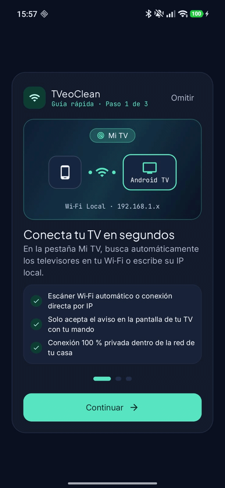
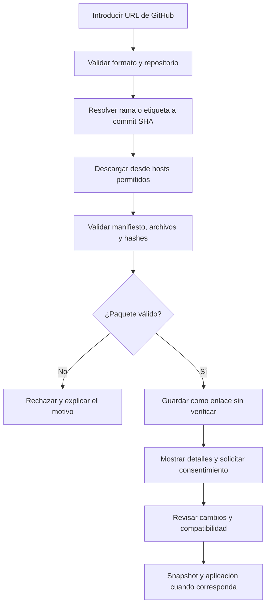

<h1 align="center">TVeoClean</h1>

<p align="center">
  <strong>Tu televisor. Tu configuración. Tu control.</strong><br>
  Centro de control para analizar, optimizar y personalizar televisores Android TV y Google TV desde el móvil.
</p>

<p align="center">
  <a href="https://github.com/ROSNLR5/TVeoClean"></a>
  
  
  
</p>

<p align="center">
  <a href="#-qué-es-tveoclean">Qué es</a> ·
  <a href="#-funcionalidades">Funcionalidades</a> ·
  <a href="#-style-studio">Style Studio</a> ·
  <a href="#-seguridad-por-diseño">Seguridad</a> ·
  <a href="#-desarrollo">Desarrollo</a>
</p>

---

## 📺 ¿Qué es TVeoClean?

**TVeoClean** es una aplicación Android orientada a dar al usuario más control sobre su televisor compatible con **Android TV o Google TV**, desde el teléfono y a través de la red local.

El proyecto reúne en una misma aplicación herramientas para inspeccionar el dispositivo, revisar aplicaciones y servicios, preparar operaciones de limpieza reversibles, gestionar puntos de restauración y personalizar la experiencia mediante **Style Studio**.

Una parte central del proyecto es su sistema de paquetes comunitarios: el usuario podrá importar temas, ajustes y perfiles desde repositorios de GitHub, revisar su contenido y decidir qué aplicar, sin confiar ciegamente en un enlace externo.

> **Estado del proyecto:** TVeoClean está en desarrollo activo. Este repositorio contiene código de la aplicación y de sus componentes principales, pero la compatibilidad, la estabilidad y la seguridad de cada operación deben seguir validándose con pruebas en dispositivos reales. Las funciones descritas aquí representan el alcance del proyecto y no equivalen a una certificación de compatibilidad para todos los televisores.

<p align="center">
  
</p>

## 🎯 Objetivos del proyecto

- Facilitar la administración de un televisor compatible sin depender de una computadora para las tareas habituales.
- Mostrar un análisis antes de proponer cambios, con explicaciones comprensibles y control explícito del usuario.
- Priorizar operaciones reversibles y conservar información suficiente para recuperar los cambios aplicados.
- Reunir temas, ajustes y perfiles comunitarios en una experiencia visual coherente.
- Incorporar controles de seguridad antes de importar o aplicar contenido externo.
- Mantener una interfaz moderna, adaptable, accesible y disponible en español e inglés.

## ✨ Funcionalidades

### Conexión y análisis del televisor

- Descubrimiento de dispositivos en la red local y opción de conexión manual.
- Comunicación con el televisor mediante **Android Debug Bridge (ADB)**, cuando el dispositivo y su configuración lo permiten.
- Gestión local de claves de conexión y validación del emparejamiento.
- Inspección de paquetes y presentación de un informe antes de ejecutar cambios.
- Clasificación de paquetes, recomendaciones conservadoras y protección de componentes esenciales.

### Limpieza reversible y recuperación

- Plan de cambios que puede revisarse antes de confirmar una operación.
- Exclusión de paquetes protegidos y del launcher activo cuando corresponda.
- Ejecución por lotes con comprobaciones del resultado.
- Creación de snapshots antes de las operaciones compatibles.
- Restauración diferencial de cambios y registro local de auditoría.
- Historial de operaciones y estados para ayudar a entender qué se modificó.

**Importante:** desactivar un paquete del sistema puede afectar funciones que dependan de él. La reversibilidad reduce el riesgo, pero no garantiza que todos los modelos se comporten igual. Antes de aplicar un perfil, revisa el plan y asegúrate de tener una forma alternativa de recuperar el televisor.

### Herramientas de control y privacidad

- Interfaz de control remoto para las acciones compatibles con la conexión establecida.
- Captura de pantalla cuando el dispositivo y el método de conexión lo permiten.
- Informe de privacidad para mostrar hallazgos y evidencias disponibles, sin asumir que todas las opciones del fabricante pueden detectarse o modificarse.
- Preferencias de idioma, apariencia y movimiento reducido.

## 🎨 Style Studio

**Style Studio** es el espacio de TVeoClean dedicado a descubrir, importar, previsualizar y administrar paquetes de personalización.

La interfaz organiza el contenido en secciones como descubrimiento, temas, ajustes, perfiles e instalaciones. El objetivo es que una persona pueda cambiar el aspecto de su experiencia sin tener que editar archivos manualmente.

### Tipos de paquetes

| Tipo | Propósito |
|---|---|
| `theme` | Apariencia visual, colores, fondos y opciones compatibles del launcher. |
| `tweak` | Ajustes declarativos que modifican opciones admitidas. |
| `debloat-profile` | Selección de paquetes candidatos a revisión para una limpieza. |
| `addon` | Extensiones compatibles, sujetas a sus requisitos y controles de seguridad. |

La posibilidad de aplicar cada paquete depende de su formato, del dispositivo conectado y de las capacidades implementadas para ese tipo de destino.

### Importar paquetes desde GitHub

TVeoClean incorpora un flujo de importación diseñado para evitar que una rama mutable o un archivo externo pueda cambiar silenciosamente después de haber sido revisado.



El importador del proyecto contempla controles como:

- Resolución de la referencia a un **commit SHA fijo**.
- Uso de hosts de GitHub permitidos para consultar metadatos y descargar contenido.
- Límites de descarga y rechazo de extensiones ejecutables o no admitidas.
- Lectura del manifiesto `tveo.json` y comprobación de los hashes SHA-256 declarados.
- Compatibilidad de importación con temas heredados que utilizan `config.json`, convirtiéndolos localmente sin modificar el repositorio de origen.
- Clasificación de los repositorios importados como **enlaces sin verificar**, salvo que exista un proceso de verificación independiente.
- Registro de las importaciones en el historial local.

#### Ejemplo de enlace

```text
https://github.com/usuario/mi-tema-tveo
```

#### Manifiesto `tveo.json`

Los paquetes nuevos utilizan un manifiesto declarativo para describir su identidad, compatibilidad y contenido. La estructura puede evolucionar con el esquema de TVeoClean; consulta la implementación vigente antes de publicar un paquete.

Como mínimo, el diseño contempla campos para:

- esquema y tipo del paquete;
- identificador, nombre, versión y autor;
- licencia y créditos;
- compatibilidad requerida;
- lista de archivos y sus hashes SHA-256;
- permisos o capacidades declaradas;
- vista previa y registro de cambios.

**Un hash válido no demuestra que el autor sea confiable.** La integridad del archivo y la confianza en quien lo publica son cuestiones diferentes. Por eso, un paquete importado desde un enlace de GitHub no debe mostrarse como oficial o verificado únicamente porque la descarga haya sido correcta.

## 🛡️ Seguridad por diseño

TVeoClean prioriza el principio de **revisar primero, confirmar después y conservar una vía de recuperación**.

- **Control del usuario:** las operaciones de limpieza deben mostrarse antes de ser ejecutadas y requerir confirmación explícita.
- **Mínimo privilegio:** se solicitan permisos relacionados con la conectividad local necesaria para descubrir y conectar con dispositivos.
- **Protección de paquetes críticos:** las recomendaciones y los perfiles se filtran frente a una lista de componentes protegidos.
- **Reversibilidad:** los cambios compatibles deben contar con un snapshot y una ruta de restauración.
- **Paquetes declarativos:** los temas y ajustes no deben poder ejecutar scripts arbitrarios.
- **Validación de contenido:** las importaciones externas pasan por comprobaciones de formato, tamaño, integridad y tipo de archivo.
- **Confianza transparente:** un paquete de terceros se identifica claramente como no verificado si no existe una verificación independiente.
- **Auditoría local:** se registran las operaciones relevantes para facilitar el diagnóstico.
- **Secretos fuera del repositorio:** nunca publiques claves API, contraseñas, almacenes de firma ni datos privados de tu red.

Estas medidas no sustituyen las pruebas de seguridad ni garantizan compatibilidad con todos los modelos y versiones de firmware. Revisa las operaciones sugeridas y utiliza solo perfiles adecuados para tu dispositivo.

## 🧭 Flujo de uso previsto

1. **Conectar:** habilita las opciones de depuración admitidas por el televisor y autoriza la conexión ADB desde la pantalla del televisor.
2. **Analizar:** TVeoClean recopila la información disponible y presenta el estado detectado sin ejecutar el plan de limpieza.
3. **Revisar:** el usuario examina las recomendaciones y selecciona los cambios que desea realizar.
4. **Aplicar:** después de confirmar, se guarda el punto de recuperación correspondiente y se comprueba el resultado de las operaciones compatibles.
5. **Restaurar:** desde el historial se puede solicitar la reversión de los cambios para los que exista información de recuperación suficiente.
6. **Personalizar:** en Style Studio se importan y revisan temas, ajustes o perfiles antes de aplicarlos.

## 📱 Compatibilidad y requisitos

### Teléfono

- Aplicación Android nativa.
- El proyecto configura actualmente `minSdk = 24` (Android 7.0) y `compileSdk = 36`; los requisitos definitivos pueden cambiar durante el desarrollo.
- Para compilar desde el código fuente se necesita Android Studio, el Android SDK y una versión de JDK compatible con el Gradle y el Android Gradle Plugin configurados en el proyecto.

### Televisor

- Alcance inicial: **Android TV y Google TV compatibles con ADB**.
- El televisor y el teléfono deben poder comunicarse a través de la red local.
- Es necesario habilitar la depuración admitida por el modelo y aceptar la autorización en el televisor.
- Las opciones disponibles varían según fabricante, versión de Android, firmware y configuración regional.

Los televisores Samsung con Tizen, LG con webOS y Roku no deben considerarse compatibles con las funciones ADB de TVeoClean. Una arquitectura extensible puede permitir investigar integraciones específicas en el futuro, pero no hace que esos sistemas sean compatibles automáticamente.

## 🧰 Tecnologías

La base del proyecto utiliza:

- **Kotlin** y **Jetpack Compose** para la aplicación Android.
- **Material 3** para los componentes de interfaz.
- **ADB sobre red local** para las operaciones compatibles con el televisor.
- **Android NSD** y herramientas de exploración de red local para descubrir dispositivos.
- **Android Keystore** para la gestión local de claves de conexión.
- **Coroutines y Flow** para tareas asíncronas y estado de interfaz.
- **Room** y **DataStore** para persistencia local.
- **OkHttp** y **Moshi** para comunicaciones HTTP y procesamiento de JSON.
- **JUnit, AndroidX Test y Robolectric** como parte de la infraestructura de pruebas.

## 🧑‍💻 Desarrollo

### Obtener el código

```bash
git clone https://github.com/ROSNLR5/TVeoClean.git
cd TVeoClean
```

### Abrir y compilar

1. Abre la carpeta `TVeoClean` desde Android Studio.
2. Espera a que se sincronice el proyecto Gradle y resuelve cualquier dependencia indicada por el IDE.
3. Selecciona una configuración de ejecución y un dispositivo Android de prueba.
4. Ejecuta las pruebas disponibles antes de probar operaciones sobre un televisor real.

Si utilizas la consola, comprueba que el repositorio tenga el Gradle Wrapper (`gradlew` o `gradlew.bat`) antes de ejecutar tareas como `assembleDebug` o `test`. No publiques claves ni archivos de firma dentro del repositorio.

### Pruebas en televisores reales

Las pruebas deben hacerse de forma gradual: empieza con inspección de solo lectura, comprueba el modelo y el firmware, revisa el plan que genera la aplicación y valida la restauración antes de aumentar el alcance de los cambios. No uses perfiles de otro modelo suponiendo que sus paquetes y dependencias son idénticos.

## 🗺️ Próximos hitos

- [ ] Validar los flujos principales en una matriz documentada de televisores y versiones de firmware.
- [ ] Publicar capturas de pantalla reales de la aplicación y ejemplos de paquetes compatibles.
- [ ] Añadir documentación detallada del esquema `tveo.json` para creadores de temas y ajustes.
- [ ] Completar las pruebas de integración del importador, los snapshots y las restauraciones.
- [ ] Definir la licencia del repositorio y documentar las licencias de terceros.
- [ ] Preparar una versión estable con identificador de aplicación definitivo, firma de publicación y comprobación de artefactos.

El estado de cada hito puede cambiar a medida que avance el proyecto; consulta los commits y las publicaciones del repositorio para conocer los cambios reales.

## 🐛 Reportar errores y proponer mejoras

Para reportar un problema, abre un [Issue](https://github.com/ROSNLR5/TVeoClean/issues) e incluye, cuando sea posible:

- marca y modelo del teléfono y del televisor;
- versión de Android y firmware de la TV;
- pasos para reproducir el problema;
- resultado esperado y resultado obtenido;
- mensajes de error relevantes, eliminando IP públicas, direcciones, números de serie, claves, códigos de emparejamiento y cualquier otro dato privado.

No adjuntes archivos de configuración que contengan secretos ni registres problemas de seguridad con detalles explotables en un issue público.

## 🔗 Proyectos de referencia

TVeoClean toma como referencias funcionales proyectos y recursos públicos de la comunidad:

- [Clean Your TV](https://github.com/Gathin23/cleanyourtv)
- [Clean Your TV App](https://github.com/udhaykumarbala/cleanyourtv-app)

TVeoClean mantiene su propia identidad y desarrollo. No implica afiliación oficial con los autores de esos proyectos. Si se incorpora código, contenido, diseños o recursos de terceros, deben conservarse sus avisos de copyright, licencias y atribuciones correspondientes.

## 📦 Descargas

Las versiones listas para instalar se publicarán en [GitHub Releases](https://github.com/ROSNLR5/TVeoClean/releases) cuando exista una versión de distribución preparada. Hasta entonces, utiliza el código fuente y evita instalar APK de fuentes no verificadas.

## 📄 Licencia

La licencia de TVeoClean debe confirmarse mediante un archivo `LICENSE` en la raíz del repositorio. Mientras ese archivo no esté publicado, no debe asumirse que el código de este repositorio se distribuye bajo MIT u otra licencia específica. Las licencias de componentes de terceros se aplican independientemente y deben respetarse.

---

<p align="center">
  <strong>TVeoClean</strong><br>
  <sub>Más control sobre tu televisor. Más libertad para personalizarlo. Siempre con una vía de recuperación en mente.</sub>
</p>
